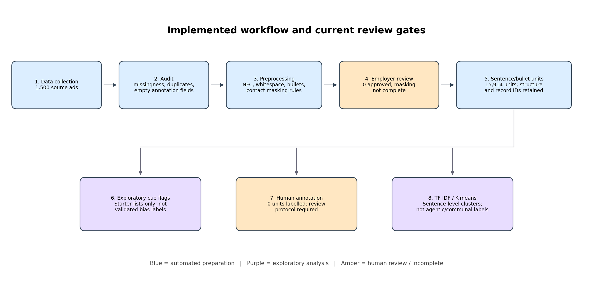
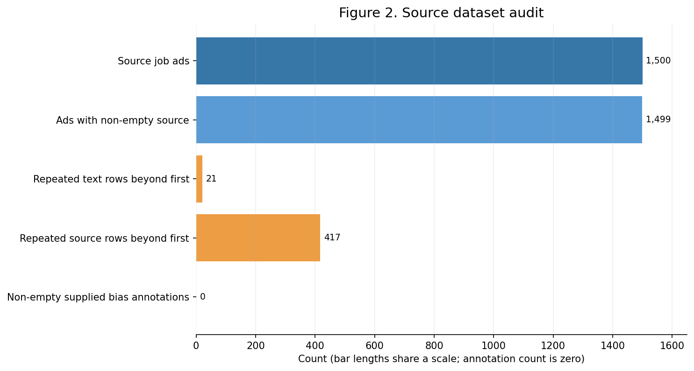
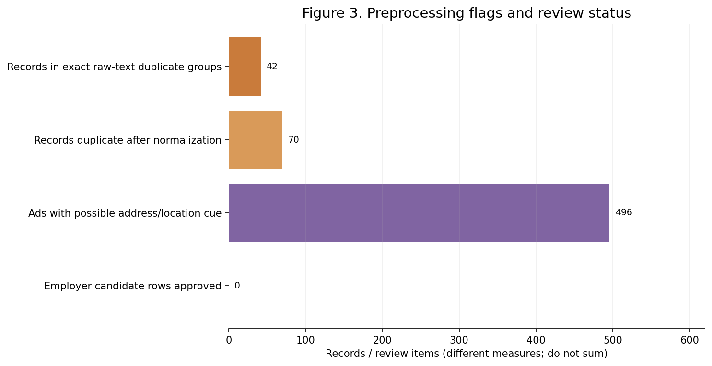
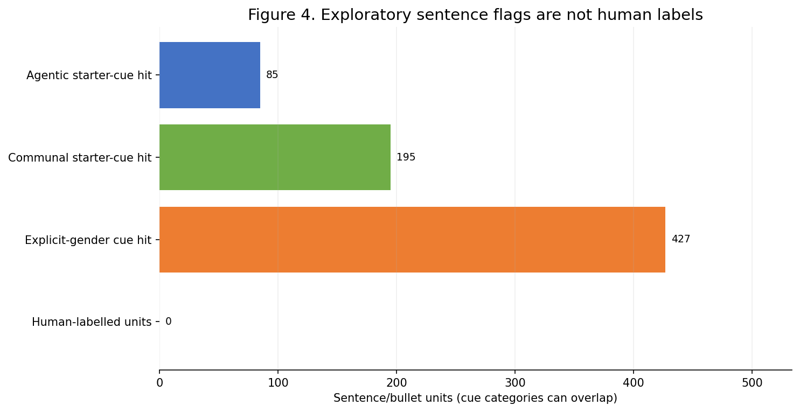
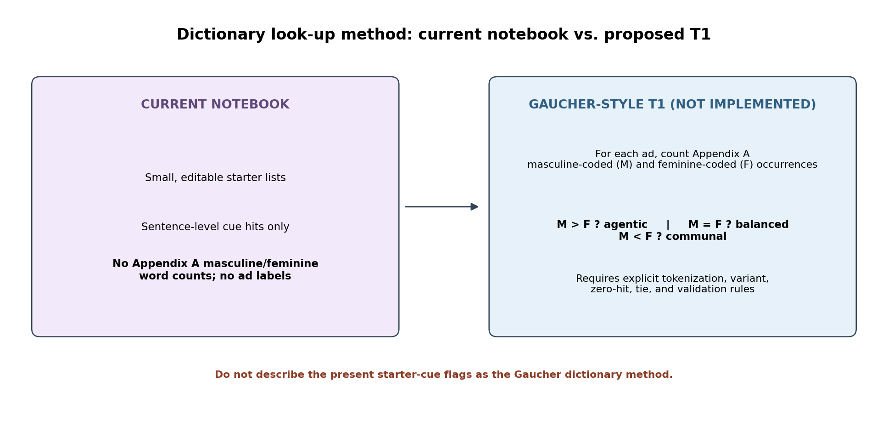
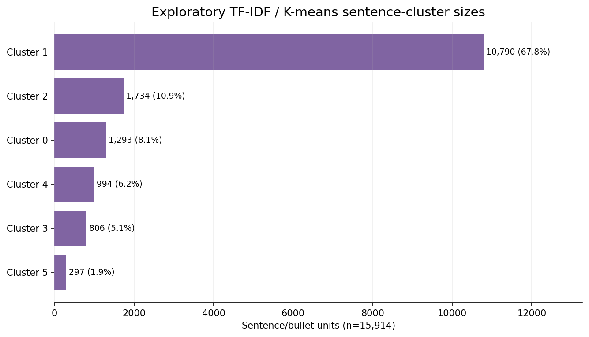

# 3. Methodology

The workflow was designed to preserve contextual language while separating
automated preparation from interpretation. It is informed by Dikshit et al.
(2024), who examine job-ad language beyond isolated gender-coded terms, but it
does not reproduce their contrastive-learning model. Related research on
gender-inclusive job-ad tools and text-level mitigation (Mihaljević et al.,
2022; Hu et al., 2022) further motivates transparent preprocessing and
caution when transferring methods across settings. Kumar et al. (2025)
examined advertisement neutrality in a downstream job-ranking context; that
ranking task is outside the present workflow.

## 3.1. Data source and corpus

The analysis used the job-advertisement dataset supplied in
[`equal-data-set.xlsx`](./equal-data-set.xlsx). The worksheet contained 1,500
records and four fields: job advertisement text, source, gender-biased
words/phrases/statements, and non-biased words/phrases/statements. A stable
record identifier was assigned to each row to maintain traceability between
the source record and its derived analysis units. The original advertisement
text and source metadata were retained separately from the text prepared for
analysis, and the source workbook was not modified.

The source field was used for provenance and quality assessment, not as
language-analysis text. One record had no source value. The two supplied
annotation fields contained no non-empty entries; consequently, they were not
treated as existing labels or as a gold-standard reference. The workbook did
not provide sufficient information to establish the collection period or a
complete sampling frame. These details should be reported from the original
collection records rather than inferred from the spreadsheet.

**Figure 1.** Stages of the implemented workflow. Amber boxes indicate
researcher-review steps that remain incomplete; exploratory outputs are not
validated bias labels.

## 3.2. Corpus audit and duplicate assessment

Before text transformation, the dataset was checked for required fields,
missing advertisement text and source values, repeated source values, exact
duplicate advertisement text, and completeness of the supplied annotation
fields. Empty source cells were counted as missing. Advertisement records were
not removed automatically: exact duplicates were flagged for review, while a
repeated source URL alone was not considered sufficient evidence that records
represented the same advertisement.

The audit identified 21 exact-text duplicate groups, comprising 42 records
(21 repeated records beyond the first occurrence), and 417 repeated source
values beyond their first occurrences. A further duplicate flag was calculated
after formatting normalization to identify records that became identical
following whitespace, line-ending, or bullet normalization. Raw-text and
normalized-text duplicate flags were retained as distinct measures. Neither
was used to delete records.

**Figure 2.** Counts from the initial corpus audit. The bars represent distinct
audit measures and should not be summed.

## 3.3. Text normalization and privacy-oriented preprocessing

Advertisement text was normalized to Unicode NFC. Carriage-return line endings
were converted to line feeds, horizontal whitespace was collapsed, selected
bullet markers were represented consistently, and runs of three or more blank
lines were reduced to two. These operations were selected to standardize
formatting while retaining linguistic and structural information. Original
wording, capitalization, punctuation, paragraph boundaries, and section
headings were otherwise preserved. Stop-word removal, stemming, lemmatization,
translation, and blanket punctuation removal were not applied.

After Step 2 masking, the dedicated modeling-normalization stage in
[`equal-step3-text-normalization.ipynb`](./equal-step3-text-normalization.ipynb)
lowercases retained modeling text, removes common bullet markers at the start
of lines, and collapses line breaks and other whitespace to single spaces.
Punctuation within the wording is retained; no words are filtered, including
gender-marked occupational nouns such as “Barista” and “Mechanic.” The Step 2
masking output remains unchanged, and the normalized text is written to a
separate Step 3 output.

Employer identity was treated as a potential source of template-related
signals. The first non-empty line of each advertisement was therefore
identified as an employer *candidate*, not assumed to be an employer name,
because it could instead represent a job title or heading. Candidates and
aliases were placed in a review file. The analysis text was configured to
replace only researcher-approved names with the placeholder `[EMPLOYER]`;
canonical names and pseudonymous employer keys were retained separately as
metadata. At the time of this analysis, no employer candidate had been
approved. Employer masking was therefore not complete, and the derived corpus
must not be described as fully employer-masked. This procedure is a
corpus-specific control and does not, by itself, demonstrate elimination of
employer-specific templates.

To limit exposure of direct contact information in model-facing text,
rule-based patterns replaced detected email addresses and URLs with typed
placeholders. Phone numbers were replaced when they appeared in labelled
contact expressions or phone-like standalone lines. Explicitly labelled
address/contact lines were also replaced. Broader street and location cues
were flagged for manual review rather than removed automatically. In the
current run, 496 records contained at least one such cue; this flag does not
establish that every flagged line was sensitive, nor that all unflagged
addresses were removed. Source URLs and raw text remained in a separate,
restricted metadata export.

The duplicate assessment was repeated on normalized text to identify
formatting-equivalent records. It identified 70 records participating in
normalized duplicate groups. These records, like raw-text duplicates, were
retained for review rather than automatically discarded.

**Figure 3.** Duplicate and privacy-review indicators from the preprocessing
stage. The displayed counts refer to different measures and are not additive.

## 3.4. Sentence- and bullet-level segmentation

For contextual review, each cleaned advertisement was divided by line, with
within-line segmentation at `.`, `!`, or `?` when followed by whitespace.
Resulting units were assigned sequential identifiers linked to the source
advertisement. Their order and record association were retained. The procedure
used a transparent punctuation rule rather than a language-specific sentence
tokenizer; it may therefore split abbreviations incorrectly or retain
headings and fragments as units. A sample of segmented text should be reviewed
before using the units for substantive interpretation.

This procedure produced 15,914 sentence/bullet units from 1,500 advertisements.
These units are analysis segments, not independent job advertisements or
independent bias observations.

## 3.5. Exploratory lexical cues and contextual annotation

The current workflow applied editable starter lists of agentic-associated
terms, communal-associated terms, and explicit gender words to sentence/bullet
units. Matching was case-insensitive and boundary-aware. Examples in the
starter lists included `assertive`, `ambitious`, and `leadership` for
agentic-associated cues, and `supportive`, `cooperative`, and `interpersonal`
for communal-associated cues. Detected terms were retained as review prompts
alongside the source unit.

These lists are exploratory and are not presented as validated lexicons for
the language varieties represented in the corpus. A detected term was not
treated as an independent determination of bias: its interpretation may depend
on context, negation, occupational requirements, and local language use.
Current-run outputs contained at least one agentic starter-cue hit in 85
units, a communal starter-cue hit in 195 units, and an explicit-gender hit in
427 units. These categories can overlap and are descriptive counts of
dictionary matches, not estimates of gender bias prevalence.

The sentence-review file provides fields for human labels, evidence spans,
and reviewer notes. The draft label set comprises `agentic`, `communal`,
`balanced`, `other`, and `uncertain`. These categories require an annotation
guide specifying their interpretation and decision rules. No human labels had
been entered at the time of this analysis. Accordingly, no
human-validated sentence- or advertisement-level bias result is reported.
Before treating these labels as research outcomes, annotators should
independently code a defined sample, disagreements should be adjudicated, and
inter-annotator agreement should be reported.

**Figure 4.** Sentence/bullet units with exploratory lexical-cue hits and
human annotations. Cue groups may overlap; the displayed automated hits are
not human labels.

## 3.6. Status of the Gaucher et al. dictionary look-up method

The current notebook did **not** implement the dictionary look-up method
described in the proposed Technique 1. Gaucher, Friesen, and Kay (2011)
describe masculine- and feminine-coded wording and provide the corresponding
word lists in Appendix A. The proposed job-ad-level procedure would count
occurrences from the specified masculine-coded and feminine-coded lists
within each advertisement and assign a category according to their relative
counts: more masculine-coded than feminine-coded occurrences would indicate
an agentic label; equal counts, a balanced label; and fewer masculine-coded
than feminine-coded occurrences, a communal label.

The notebook instead applies short, editable starter lists to
sentence/bullet-level text as exploratory cues. It does not implement the
Appendix A lexicon, maintain separate Appendix A masculine and feminine
counts, or assign the proposed Technique 1 labels to advertisements. The
current starter-cue output must therefore not be described as a Gaucher
dictionary analysis.

If this technique is adopted in a subsequent analysis, the Appendix A terms
and any permitted variants should be transcribed from the cited source and
documented with the analysis materials. Tokenization, case normalization,
word variants, multiword expressions, repeated occurrences, and the handling
of ties and advertisements with zero matches should be specified before
analysis. Both word-category counts and the resulting rule-based category
should be reported. In particular, an advertisement with zero matches in
both categories should be distinguished from an advertisement with equal,
non-zero counts; the former supplies no dictionary evidence of balanced
wording. The resulting labels should be assessed against contextual human
review, including relevant local and mixed-language expressions.

**Figure 5.** Difference between the notebook's present sentence-level
starter cues and the proposed, but not yet implemented, Appendix A-based
job-ad-level method.

## 3.7. Exploratory clustering

Sentence/bullet units were represented using TF-IDF features with unigram and
bigram terms. K-means clustering was run with six clusters and random seed 42.
The analysis was performed on sentence/bullet vectors; it did not calculate
sentence embeddings, average embeddings at the advertisement level, or cluster
whole advertisements. This baseline is distinct from the contrastive-learning
and sparse-embedding approach discussed by Dikshit et al. (2024). The assigned
cluster identifiers are arbitrary and were not interpreted as agentic,
communal, or balanced categories.

Cluster sizes were uneven. The largest cluster contained 10,790 of 15,914
units (67.8%). Its top terms included contact-related language, while other
clusters included qualification, location, or explicit-gender terms. This
distribution indicates that the current clusters may capture advertisement
structure, repeated boilerplate, or contact and requirement language in
addition to any trait-related content. Cluster sizes and terms are therefore
reported as diagnostics, not as validated findings about gendered language.
Representative units from each cluster and the stability of the results under
alternative preprocessing choices and cluster counts should be examined
before substantive interpretation.

**Figure 6.** Sizes of the six exploratory TF-IDF/K-means sentence/bullet
clusters. Cluster numbers are identifiers only and do not denote bias
categories.

## 3.8. Advertisement-level analysis and interpretation

The current analysis did not assign job-ad-level labels using either the
Appendix A dictionary procedure (Technique 1) or the embedding-based procedure
(Technique 2). In particular, sentence embeddings were not averaged to form
advertisement representations, and advertisements were not clustered.
Consequently, neither the exploratory sentence cues nor the sentence-level
TF-IDF clusters should be reported as job-ad-level agentic, communal, or
balanced classifications.

Following completion and validation of human annotation, descriptive
advertisement-level summaries may be calculated from the reviewed sentence
labels, with the number of annotated units and missing labels reported.
Dictionary-based and embedding-based approaches, if subsequently approved,
should be analyzed and reported as distinct methods. Their classifications
should not be collapsed into a single label without a prespecified rule and
validation. Text-based results alone do not establish effects on who applied,
was hired, or experienced discrimination.

## 3.9. Reproducibility and current analysis status

The notebook records the transformation and review outputs in separate files
and uses random seed 42 for K-means. The source workbook remains unchanged.
Raw text, source URLs, and employer metadata should be treated as restricted
research data.

| Measure | Current run |
|---|---:|
| Source job advertisements | 1,500 |
| Missing source values | 1 |
| Exact raw-text duplicate groups | 21 groups; 42 records |
| Records in normalized-text duplicate groups | 70 |
| Employer candidates approved for masking | 0 |
| Records with a possible address/location review cue | 496 |
| Sentence/bullet units produced | 15,914 |
| Units with human annotations | 0 |
| Gaucher Appendix A job-ad labels | Not implemented |
| Sentence-embedding job-ad labels | Not implemented |

### References

- Borchers, C., et al. (2022). “Looking for a Handsome Carpenter! Debiasing
  GPT-3 Job Advertisements.” *Proceedings of the 4th Workshop on Gender Bias
  in Natural Language Processing*. https://aclanthology.org/2022.gebnlp-1.22/
- Dikshit, M., Bouamor, H., & Habash, N. (2024). “Investigating Gender Bias
  in STEM Job Advertisements.” *Proceedings of the 5th Workshop on Gender Bias
  in Natural Language Processing*, 179–189.
  https://aclanthology.org/2024.gebnlp-1.11/
- Gaucher, D., Friesen, J., & Kay, A. C. (2011). “Evidence That Gendered
  Wording in Job Advertisements Exists and Sustains Gender Inequality.”
  *Journal of Personality and Social Psychology*, 101(1), 109–128.
  https://doi.org/10.1037/a0022530
- Hu, S., et al. (2022). “Balancing Gender Bias in Job Advertisements With
  Text-Level Bias Mitigation.” *Frontiers in Big Data*.
  https://doi.org/10.3389/fdata.2022.805713
- Mihaljević, H., Müller, I., Dill, K., & Yollu-Tok, A. (2022). “Towards
  gender-inclusive job postings: A data-driven comparison of augmented writing
  technologies.” *PLOS ONE*, 17(9), e0274312.
  https://doi.org/10.1371/journal.pone.0274312
- Kumar, D., Masoudian, S., Melchiorre, A. B., & Schedl, M. (2025).
  “Mitigating Gender Bias in Job Ranking Systems Using Job Advertisement
  Neutrality.” *Proceedings of the Fourth Workshop on NLP for Positive
  Impact*. https://aclanthology.org/2025.nlp4pi-1.23/
